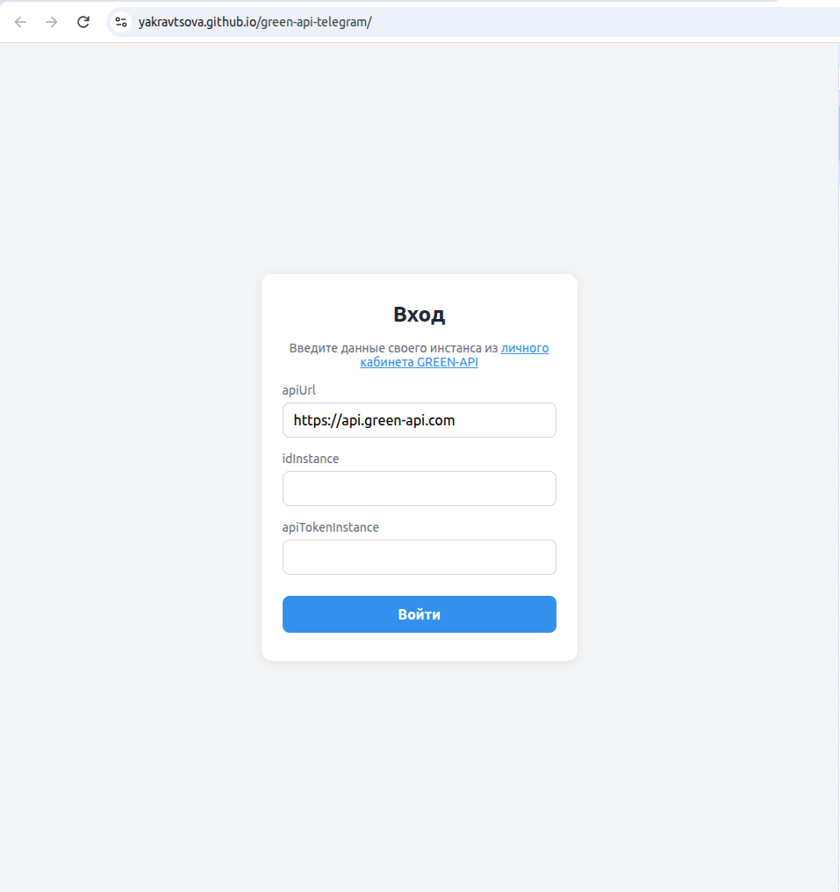
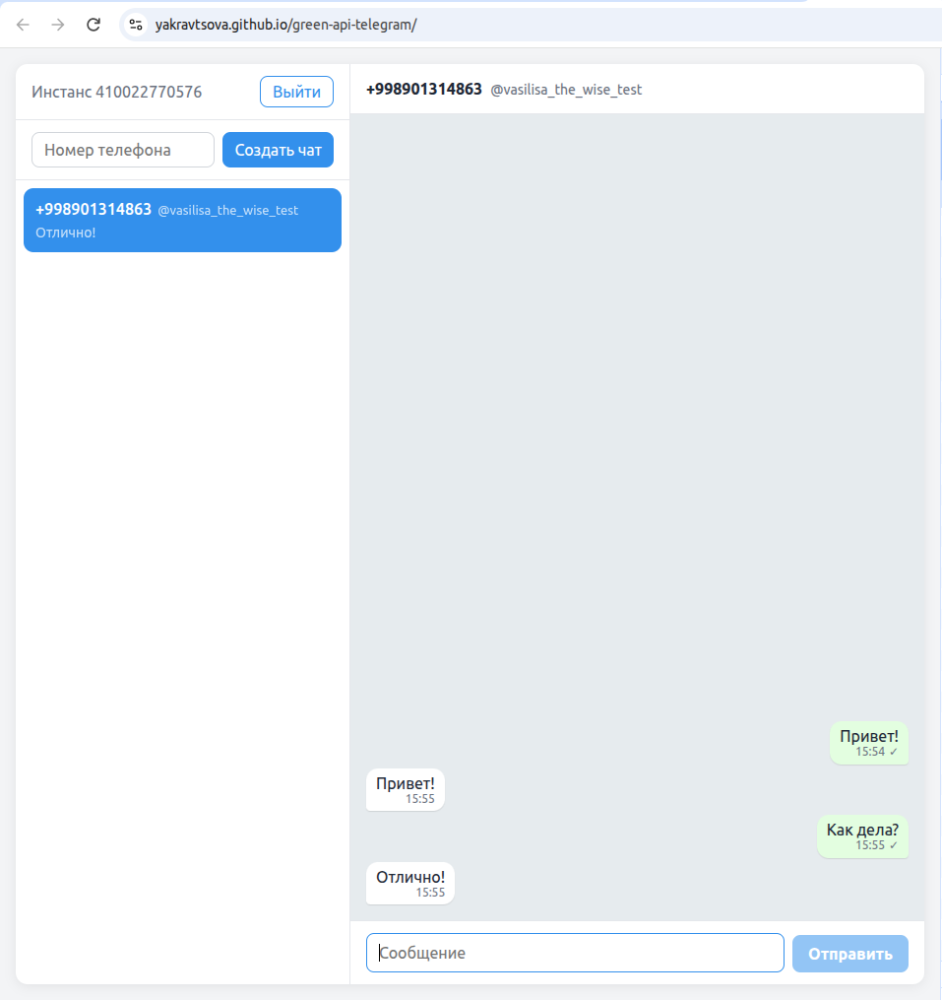
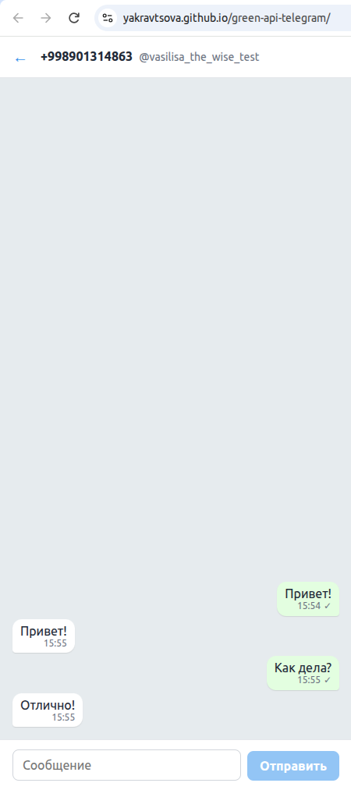

# GREEN-API Telegram Chat

Тестовое задание GREEN-API на должность «Фронтенд разработчик React»: веб-чат, который отправляет и принимает текстовые сообщения Telegram через [HTTP API GREEN-API](https://green-api.com/telegram/docs/).

**Демо:** https://yakravtsova.github.io/green-api-telegram/

Для входа нужен свой инстанс GREEN-API для Telegram, см. [Подготовка инстанса](#подготовка-инстанса).

## Скриншоты

| Вход                                       | Чат                                     |
| ------------------------------------------ | --------------------------------------- |
|  |  |

На телефоне показывается либо список чатов, либо открытый чат:

<p>
  
  
</p>

## Возможности

- Вход по `apiUrl`, `idInstance` и `apiTokenInstance` с проверкой, что инстанс авторизован. Сессия сохраняется до выхода.
- Новый чат по номеру телефона: номер проверяется через `checkAccount`, чат получает настоящий `chatId` Telegram.
- Отправка сообщений (`sendMessage`) со статусами «отправляется», «отправлено», «не отправлено».
- Приём сообщений через очередь уведомлений (`receiveNotification` + `deleteNotification`):
  - входящие от собеседника, включая незнакомых — для них чат создаётся автоматически;
  - отправленные вами из самого Telegram (с телефона или десктопа).
- Список чатов в духе мессенджера: чат с новым сообщением поднимается наверх, видно последнее сообщение.
- Адаптивная вёрстка: на узком экране — либо список чатов, либо открытый чат.

## Запуск

Нужен Node.js 20 или новее.

```bash
npm ci
npm run dev
```

Откройте адрес, который выведет Vite (обычно http://localhost:5173), и введите данные инстанса.

### Подготовка инстанса

1. В [личном кабинете GREEN-API](https://console.green-api.com/) создайте инстанс для Telegram и авторизуйте его.
2. Возьмите на странице инстанса `apiUrl`, `idInstance` и `apiTokenInstance`.
3. В настройках инстанса включите уведомления о входящих сообщениях. Чтобы в чате появлялись сообщения, написанные из самого Telegram, включите и уведомления о сообщениях, отправленных с телефона.

## Скрипты

| Команда                           | Что делает                                   |
| --------------------------------- | -------------------------------------------- |
| `npm run dev`                     | dev-сервер                                   |
| `npm run build`                   | проверка типов и production-сборка в `dist/` |
| `npm run preview`                 | локальный просмотр сборки                    |
| `npm test`                        | unit- и интеграционные тесты (Vitest)        |
| `npm run test:watch`              | тесты в режиме наблюдения                    |
| `npm run lint`                    | ESLint                                       |
| `npm run format` / `format:check` | Prettier                                     |

## Стек

React 19, TypeScript, Vite, CSS Modules. Тесты: Vitest, React Testing Library, jsdom. Без UI-библиотек и без стейт-менеджера.

## Архитектура

```
src/
  api/            HTTP-клиент GREEN-API и типы запросов/ответов
  auth/           вход: проверка инстанса, хранение сессии, AuthContext
  state/          chatReducer (чаты и сообщения), поиск чата по номеру, заголовок чата
  notifications/  разбор уведомлений и цикл их получения
  lib/            нормализация номера телефона
  components/     LoginForm, ChatPage, Sidebar, NewChatForm, ChatWindow, MessageBubble, MessageComposer
```

### Состояние без стейт-менеджера

Глобального состояния немного, и Redux или Zustand добавили бы только шаблонный код.

- **Учётные данные** — в `AuthContext` (`AuthProvider`) и в `localStorage`. Нужны и форме входа, и странице чатов.
- **Чаты и сообщения** — в `useReducer` внутри `ChatPage`. Редьюсер — чистая функция, поэтому каждое действие покрыто тестами без рендера компонентов.

Действия: `chatCreated`, `chatSelected`, `chatClosed`, `messageSending`, `messageSent`, `messageFailed`, `messageReceived`.

### Отправка

Сообщение сразу появляется в ленте со статусом «отправляется» и локальным `id` (оптимистичное обновление). После ответа `sendMessage` статус меняется на «отправлено», и записывается серверный `idMessage`. При ошибке статус становится «не отправлено».

### Получение

`useNotificationsPolling` запускает `pollNotifications`, пока открыта страница чатов:

1. `receiveNotification` с `receiveTimeout=20`: сервер держит запрос до 20 секунд, пока не появится уведомление (long polling).
2. Пустой ответ означает, что очередь пуста, и запрос сразу повторяется.
3. Уведомление разбирается (`parseNotification`) и **всегда** удаляется через `deleteNotification`, даже если оно не нужно. Иначе очередь не сдвинется.
4. При ошибке — пауза 5 секунд и повтор.

Цикл останавливается через `AbortController`, когда пользователь выходит или страница размонтируется. Если `deleteNotification` не прошёл и уведомление пришло снова, редьюсер не добавит дубль: сообщения сверяются по `idMessage`.

## Ограничения

- **Только текст.** Картинки, файлы, голосовые и другие типы сообщений игнорируются. Ссылки с превью (`extendedTextMessage`) показываются как текст.
- **Только личные чаты.** Уведомления из групп и каналов пропускаются.
- **Нет истории.** Переписка хранится в памяти и пропадает при перезагрузке страницы. Сообщения, отправленные до открытия приложения, не подгружаются.
- **Токен в `localStorage`.** Это удобно, но при XSS-уязвимости токен можно украсть. В реальном продукте токен должен жить на бэкенде, а браузер — ходить через него.
- **Номера.** Замена `8` → `7` в начале 11-значного номера рассчитана на Россию. Номера других стран нужно вводить с кодом страны.
- **Поиск по номеру.** Если собеседник скрыл номер в настройках приватности Telegram, `checkAccount` его не найдёт. Писать такому собеседнику можно только после того, как он напишет первым.
- **Одна вкладка.** Очередь уведомлений у инстанса одна: если открыть приложение в двух вкладках, каждое уведомление получит только одна из них.
